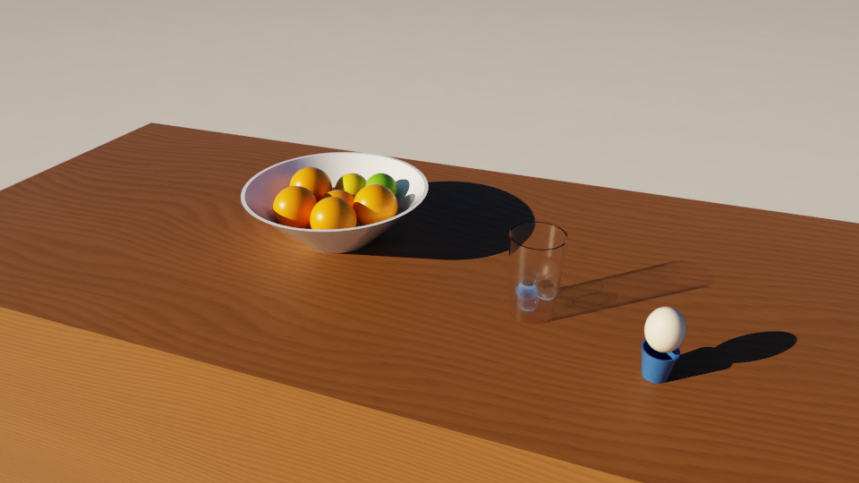

# Shafin - VL: images from text-only language models

VL is a small text language for 3D scenes, plus a self-contained physically based renderer.
A language model that can only write text writes a VL program; the `vl` tool checks it,
describes the resulting picture in words and numbers (so no vision is needed), and renders it.

```
plane ground { material: plaster }
box counter { size: [1.6, 0.9, 0.7], material: wood }
cup bowl { radius: 6cm, top_radius: 15cm, height: 9cm, on: counter, material: ceramic, color: white }
for i in 0..5 { sphere orange { radius: 3.6cm, in: bowl, color: orange } }
sky { time: morning }
camera { look_at: bowl }
```



(`examples/fruit_bowl.vl`. Nothing in the bowl has coordinates; `in: bowl` puts each thing
where it comes to rest.)

**Status: work in progress.** The pipeline runs end to end and the light transport is
validated against closed-form radiometry. The images are clean computer-graphics renders
of simple solids, not photographs. In two experiments, small language models (1.5B to 3B
parameters) mostly failed to produce the picture they were asked for; a 20B model
succeeded on some scenes. `docs/STATUS.md` says exactly what is and is not done.

## Build and run

Rust (stable) is the only requirement; there are no third-party dependencies.

```
cargo build --release
./target/release/vl check   examples/still_life.vl
./target/release/vl inspect examples/still_life.vl
./target/release/vl render  examples/still_life.vl -o still_life.png --width 1280
cargo test --release
```

## Where things are

| Path | Contents |
|---|---|
| `skills/vl-scene/` | Agent Skill: how a model should use the tool, and the one-page language reference |
| `docs/architecture.md` | design, what is validated, every deliberate approximation, known limits |
| `docs/STATUS.md` | current state, open defects, resource usage |
| `docs/experiments/` | the two language-model experiments, with every number and its caveats |
| `docs/research/00-source-notes.md` | literature notes and measured facts about the environment |
| `crates/` | `vl-core`, `vl-image`, `vl-ir`, `vl-lang`, `vl-render`, `vl-cli` |
| `tools/ci/`, `.github/` | workflows that fetch the toolchain and run language-model experiments |

Licence: MIT OR Apache-2.0.
