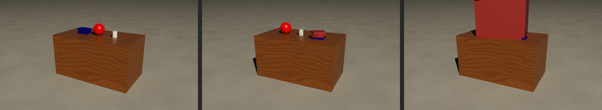
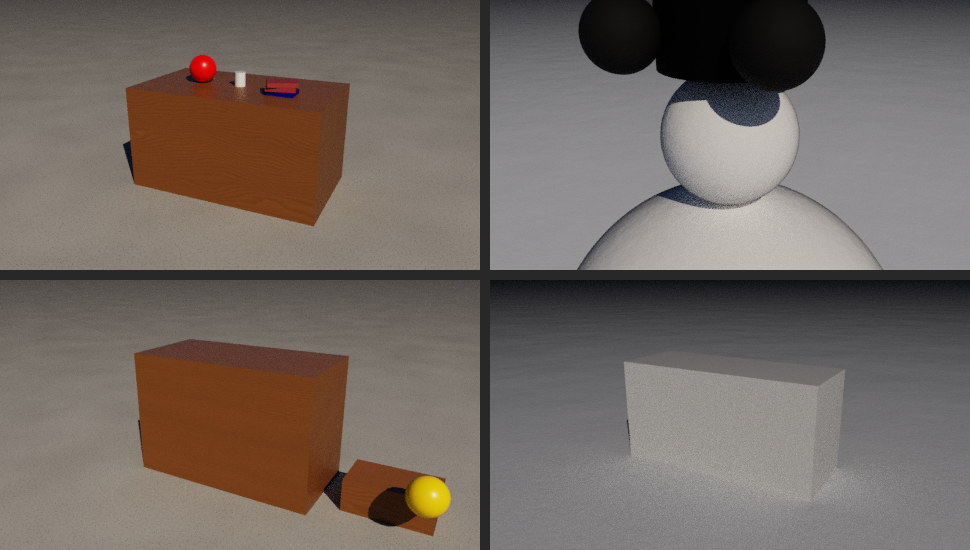

# Experiment 1: can small language models write VL?

Run 43587377319 on 2026-11-14, source commit `3ae625e`. Raw data (every prompt, reply,
diagnostic and image) is on the remote at `refs/vl-results/llm-experiment`; fetch it with
`git fetch origin refs/vl-results/llm-experiment && git checkout FETCH_HEAD` in an empty clone.

## Setup

- Three models, three scene descriptions, up to three rounds each. Round 1: the model gets
  the one-page language reference (831 words) and a one-sentence description, and replies
  with a program. Later rounds: it gets the compiler's messages or, once the program is
  valid, a text report of what the rendered picture contains.
- `qwen2.5-coder:1.5b` and `qwen2.5-coder:3b` ran on the GitHub runner's two CPU cores
  through Ollama. `gpt-oss-20b` was a hosted model at `text.pollinations.ai`; the language
  reference and the three descriptions were sent to that third-party service.
- Descriptions: a desk with objects on it; a snowman; a room corner at night lit by a lamp.

## Result

**No run produced a picture of the scene it was asked for.**

| model | desk | snowman | night room |
|---|---|---|---|
| gpt-oss-20b (hosted) | valid after 2 rounds | no reply (see below) | no reply (see below) |
| qwen2.5-coder 1.5B | valid at once | errors in all 3 rounds | valid at once |
| qwen2.5-coder 3B | errors in all 3 rounds | errors in all 3 rounds | errors in all 3 rounds |

Three of nine runs ended with a program that compiles. That number overstates the outcome:

- All three valid programs are near-copies of the worked example in the language reference
  (a table with a ball, a mug and a stack of books). The 1.5B model reproduced it almost
  word for word, comment included. The desk description was too close to the example to
  tell copying from understanding.
- The valid "night room" is the same example with a stack of red boxes called "sofa" added.
  It is in daylight.

Two of the six failures are faults of the experiment, not results about the models: the
hosted model spends its output allowance on hidden reasoning, the harness allowed 1500
tokens, and the service answered "exhausted its output token limit". Its first desk reply
was cut off in mid-statement for the same reason.

## What the transcripts show

1. **A small model does not recover from an error.** Four runs began with a compile error;
   none was valid three rounds later. In round 3 the models returned their round-2 program
   unchanged.
2. **They act on the first message only.** Shown a warning followed by two errors, the 3B
   model fixed the warning.
3. **A hint that contains code is copied, badly.** "define it first with `let name = value`"
   produced `let snow = material { ... }` and `let snow = material: snow` - new syntax
   errors on top of the old ones.
4. **The failures were mostly vocabulary.** `material: snow`, `color: dark`,
   `material: white`, `light sky { sun_elevation: 40 }`, `on: ground, at: [x, y, z]`,
   `strength: 500` for a lamp. Each has one obvious meaning. The 3B model's snowman was a
   correct stack of three spheres with a hat; two unknown words stopped it.
5. **Nine copies of one message** ("unknown name 'snow'") filled the feedback, at a cost of
   about a minute of reading for a model on two CPU cores.
6. **The inspection report raised a false alarm**: a lamp outside the picture was reported
   as a problem. It was the only finding on an otherwise acceptable scene.
7. **"Night" needs a word.** The default sky is daylight, so a lamp changed nothing, and no
   model knew to turn the sun off.

## What was changed in response

- Anything with one sensible reading is accepted, with a warning that says what was
  assumed (codes W340-W348): unknown or misspelt colours, materials, properties and names;
  a colour given as the material; three numbers for `at` beside `on`; the sun written as a
  light; a statement that tries to modify an existing object.
- More vocabulary: all CSS colour names (case, `_` and `-` ignored), eight new materials
  including `snow`, about fifty other words for materials, `sky { time: night }` and six
  other times of day, common synonyms for property names.
- A scene that has lamps and says nothing about the sky is lit by its lamps.
- While there are errors only errors are shown; repeated messages are merged; no hint
  contains code that could be pasted in the wrong place.
- Lamps out of view are no longer reported.
- The failing programs are kept as test data (`crates/vl-lang/tests/data/llm/`). Four of
  the six that failed in round 1 now compile; the pictures they give are below. The two
  that still fail were cut off or use invented syntax.

Top left: the example again. Top right: the 3B model's snowman, as it wrote it - the
camera is aimed at the 10 cm head, and the "eyes" sit on top of it. Bottom left: its night
room. Bottom right: the 1.5B model's "snowman", a white box.

These are better outcomes than "no picture", and they are not good pictures. Accepting more
programs was the cheap half of the problem. The models' scenes are a few primitive shapes;
that is what limits the pictures now.

## What this does not show

- Nine runs, one attempt each, are an observation, not a rate.
- The changes were made after seeing these transcripts. Whether they help on descriptions
  and models not seen before is unknown until the experiment is repeated.
