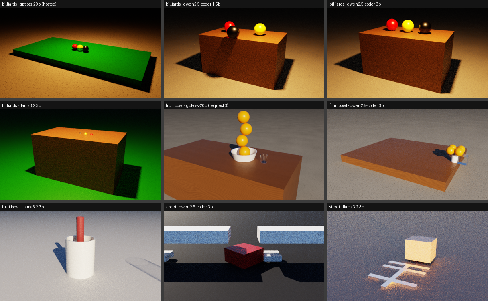
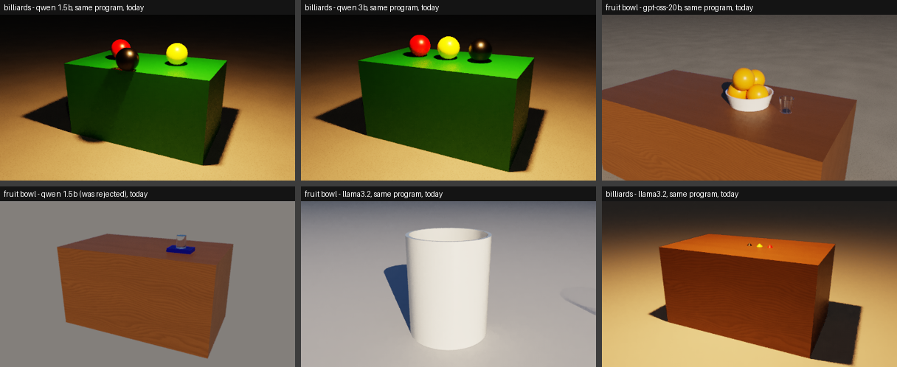

# Experiment 2: new prompts, one new model family

Two workflow runs on 2026-11-14:

- request 2 - run 43607638534, source commit `408798a`: four models, three scene descriptions;
- request 3 - run 43609335998, source commit `a501a0e`: the hosted model again, on the two
  descriptions it had not answered.

Raw data (every prompt, reply, diagnostic, inspection report and image) is on the remote at
`refs/vl-results/llm-experiment-r2-b0` ... `-b3` and `refs/vl-results/llm-experiment-r3-b0`.
Fetch one with `git fetch origin <ref> && git checkout FETCH_HEAD` in an empty clone.
The programs are also in `crates/vl-lang/tests/data/llm2/`, byte for byte.

## Why a second experiment

After experiment 1 the compiler and the language reference were changed using that
experiment's own transcripts. Running the same descriptions again would have measured how
well the compiler had been fitted to them. So:

- **three new descriptions**, fixed before any model saw them, none resembling the worked
  example in the reference:
  - *billiards*: three billiard balls (red, yellow, black) next to each other on a table
    covered with green cloth, lit by a single lamp hanging above; the room is dark;
  - *fruit bowl*: a white bowl holding four oranges on a kitchen counter, a drinking glass
    beside it, morning sunlight;
  - *street*: a street at dusk - grey road, a row of four street lamps (tall thin pole,
    glowing ball on top), a red car made of two boxes with four dark wheels;
- **one model whose output had never been seen** while the language was being changed:
  `llama3.2:3b` (a general chat model; the others are `qwen2.5-coder` 1.5B and 3B and the
  hosted `gpt-oss-20b`).

Protocol as before: the model gets the one-page reference (948 words) and one description;
its program goes through `vl check`; it is shown the diagnostics, or - once the program is
valid - the text of `vl inspect`, and may send a new program, up to three rounds. New in
this run: a pair stops when the model sends back the very program it sent before.

Before the run I wrote a program of my own for each description to make sure the language
can express it (it can; the three pictures are recognisable). I also used those three
programs to adjust two things: how the automatic camera frames `look_at`, and when the
inspection calls something "hidden". So the tool was not blind to these descriptions,
only to what models would write for them. No model output for them existed at that point.

## What was measured

Fourteen attempts on twelve (model, description) pairs. "valid" means `vl check` accepted the
program; it says nothing yet about the picture.

| model | billiards | fruit bowl | street |
|---|---|---|---|
| gpt-oss-20b (hosted) | valid at once, nothing to report | request 2: no reply (HTTP 400). Request 3: valid at once, improved twice from the inspection report, then nothing to report | request 2: no reply (HTTP 400). Request 3: errors in all three rounds (9, 7, 4); the third reply contained no program |
| qwen2.5-coder 1.5B | valid at once (2 warnings); answered DONE | 8 errors; then the identical program again | 5 errors; then the identical program again |
| qwen2.5-coder 3B | valid at once (2 warnings); answered DONE | valid at once (5 warnings); answered DONE | valid at once (11 warnings, 6 findings); answered DONE |
| llama3.2 3B | 1 error, repaired in round 2, 7 warnings left | valid at once; round 2 broke it (2 errors); then the identical program again | valid at once; round 2 broke it (1 error, cut off at the token limit); then the identical program again |

Counting each pair once (the hosted model's two retries count as its attempt at that pair):

| | of 12 pairs |
|---|---|
| a program that compiles on the first attempt | 8 |
| a program that compiles at some point | 9 |
| started with errors and was repaired by the feedback | 1 of 4 |
| started valid and was broken by a later round | 2 |
| ended valid with nothing left to report | 2 (both the hosted model) |

For comparison only - different descriptions, one more model, so this is not a controlled
before-and-after: in experiment 1, 2 of 9 pairs compiled on the first attempt and 3 of 9 at
some point. The two qwen models went from 2 of 6 to 4 of 6 on the first attempt.

## What the pictures show

A program that compiles is not a picture of the scene. I compared each rendered picture
with its description myself; one judge, not blind, so treat this as a description rather
than a score.

- **Shows the scene: 1 of 12.** The hosted model's billiards: three balls in a row on a
  green table, one lamp, dark room.
- **Recognisable, with a clear fault: 4.**
  - Both qwen models' billiards: balls, lamp and dark room are right, the table is brown.
    Each wrote the cloth as a second box of exactly the table's size in the same place, and
    the renderer showed the table.
  - The hosted model's fruit bowl: bowl, counter, glass and sunlight are right; the four
    oranges stand on top of one another in a tower. It gave four 16 cm oranges positions
    4 cm apart, the language kept those positions and stacked them - and then reported
    nothing wrong.
  - The 3B qwen's fruit bowl: four oranges balanced on a mug-sized cup. It copied the cup's
    measurements from the reference's example.
- **Not the scene: 4.** The 3B qwen's street (slabs for lamps, one small box for the car);
  all three llama pictures (it used `cup` for balls, oranges and the glass, and coloured the
  floor instead of the table).
- **No picture: 3.** The 1.5B qwen's fruit bowl and street, the hosted model's street.

## What the transcripts show

1. **The vocabulary fixes from experiment 1 carried over to new descriptions and to a new
   model.** `material: green`, `material: grey`, `light sky { time: morning }`,
   `at: [x, y, z]` beside `on:`, a repeated name - each occurred again, each was accepted
   with a note saying how it was read. Under the experiment-1 compiler each was an error.
2. **Offered the choice, a small model declares itself finished.** The valid-program message
   ends "if the picture is right, reply DONE". The 3B qwen answered DONE all three times -
   once with 17 remarks open - and the 1.5B once. The feedback loop was never used by them.
   This is a property of the prompt as much as of the models; the next run should not offer
   the choice while remarks are open.
3. **When a small model did revise, it did as much harm as good.** llama3.2 repaired one
   program and broke two that had been valid, inventing a `... for i in 1..4` suffix.
4. **The 1.5B model does not react to feedback at all**: both times it returned its program
   unchanged. It writes valid programs only near the reference's example (billiards on a
   table); for the fruit bowl it left out the kind words (`bowl { size: ... }`) and gave the
   oranges the example mug's properties.
5. **Everything in the reference's examples is copied**: the table size `[1.4, 0.75, 0.8]`,
   the mug's `radius: 0.04, height: 0.1`, the material name `tiles`, the loop with
   `hsv(i * 80, 0.6, 0.6)` and even its comment. After `cup` appeared in the example,
   llama3.2 used `cup` for every object.
6. **The capable model used the language as intended** - its own material for the cloth,
   real ball sizes, `cup` and `in:` for the bowl, the inspection report to fix its camera -
   and failed on the hardest description, where with reasoning effort set to low it wrote
   `define lamp { ... }` without parentheses and loose `on:` lines to arrange parts.
7. **The tool missed two wrong pictures.** The coincident cloth and table produced a warning
   about overlap, not about which one would be visible; the tower of oranges produced
   nothing.

## Faults of the experiment itself

- In request 2 the hosted service rejected two of three prompts with "exhausted its output
  token limit" although the limit sent was 12 000 tokens. Request 3 asked for low reasoning
  effort and got answers; it also ran into the service's free-tier limit of one reply per
  45 seconds, which the harness's pause of 16 seconds did not respect (it retried and went
  on). The hosted model therefore ran under two different settings.
- The hosted model's reasoning effort was lowered to get any answer at all. Its failure on
  the street scene may partly be a result of that.
- Three descriptions, one sample each, temperature 0.2: the numbers above are counts, not
  rates. No confidence interval can be put on any of them.

## Changes made afterwards

Made after reading these programs, so their effect has **not** been measured:

- Two surfaces in the same place: the smaller thing is seen, and of two things the same
  size the one written later. The overlap warning now says which.
- Balls put in a vessel settle as a heap: a ball rolls off the one it was set on and those
  already there make room. Positions given with `at:` are where a ball is put down, not
  where it must stay.
- A statement may refer to something created further down; `table { size: ... }` without
  its kind is read from its properties; shade words (`dark_black`, `darkwood`); a cup may
  close to a point; spelling help no longer turns `table` into `marble`.

The same programs under today's compiler - a replay on the data the changes were made
from, shown to document the changes and for no other purpose:

The two qwen billiards and the hosted fruit bowl now show their scenes. The 1.5B qwen's
fruit bowl now compiles and shows a navy slab and a cylinder on a table: being accepted did
not make it a picture of a bowl of oranges. The llama pictures are unchanged in substance.

## What this does and does not show

- It shows that a 20B open-weight model can write VL from one page and get the picture it
  was asked for: as measured, on one of three descriptions. On a second its program was
  right and the picture was spoilt by how the tool stacked the oranges; that has been
  changed, and the changed behaviour has not been measured on anything new.
- It shows that 3B models now mostly produce programs that compile, and that compiling is
  not the obstacle any more: their pictures are wrong because of what they chose to build.
- It does not show that small models "can use VL to make images". On these descriptions
  they could not, and the feedback loop did not help them.
- Nothing here measures photorealism. The pictures are clean renders of simple solids.

## Cost and data

- Runner time: 37 job-minutes for request 2 and 9 for request 3 (each job rounded up to a
  full minute, as GitHub bills private repositories).
- The hosted backend sent the language reference, the three descriptions, the model's own
  programs and the tool's reports about them to `text.pollinations.ai`. Nothing else left
  the runner. The other three models ran on the runner itself.
